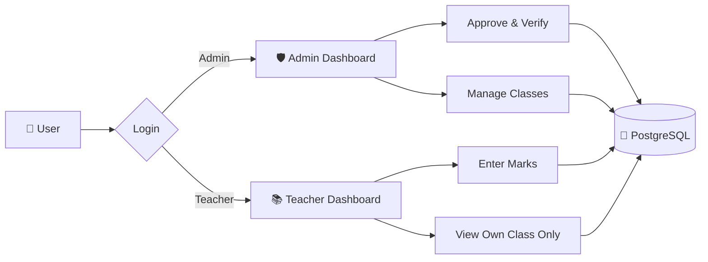

<!-- ============ HERO ============ -->
<div align="center">


<a href="https://hellocoder.online">
  
</a>

<br/>


<a href="https://github.com/CyberLeafy?tab=followers"></a>
<a href="https://github.com/CyberLeafy?tab=repositories"></a>

</div>

<!-- ============ NAVBAR ============ -->
<div align="center">

[](#)
[](#-about-me)
[](#-featured-project)
[](#-tech-stack)
[](#-github-stats)
[](#-lets-connect)

[](https://hellocoder.online)

</div>

---

<!-- ============ ABOUT ============ -->
## 👋 About Me

<div align="center">


</div>

```python
class Aditya:
    name      = "Aditya Jaiswal"
    role      = "Developer"
    location  = "India 🇮🇳"

    focus     = ["Backend architecture", "APIs", "Databases", "Geospatial apps"]
    stack     = ["Python", "Flask", "FastAPI", "PostgreSQL", "React Native"]
    shipped   = ["StudyVault (Android)", "tgclip (PyPI CLI)", "School Management System"]
    exploring = ["System design", "Performance optimization", "Open source"]
    values    = ["Data integrity", "Scalability", "Maintainability"]

    def mission(self):
        return "Build real-world software that solves real problems."

    def open_to(self):
        return "Backend-heavy, real-world collaborations 🤝"
```

<div align="center">
<table width="100%>
<tr>
<td align="center">
<h2>❝</h2>
<h3><i>An editor is my canvas, and code is my art.</i></h3>
<sub>✦ Aditya Jaiswal ✦</sub>
</td>
</tr>
</table>
<br/><br/>

<a href="https://hellocoder.online"></a>
<a href="mailto:hello.adityajaiswal@gmail.com"></a>

</div>

---

<!-- ============ PROJECTS ============ -->
## 🚀 Projects

> **Not a demo. Not a tutorial. Real systems built for real usage.**

### 🌟 Latest Releases

<table>
<tr>
<td width="50%" valign="top">

#### 📚 StudyVault
**Offline-first Android app to organize study screenshots.**


Turn hundreds of scattered gallery screenshots into a clean **Subjects → Chapters → Sections** hierarchy.

- 📥 Share-to-import from any app
- 🖼️ Gallery with zoom & swipe
- 📅 Study tracker timeline
- 🔒 Privacy-first, works fully offline

[🌐 Website](https://studyvault.hellocoder.online/) · [📖 Docs](https://studyvault.hellocoder.online/docs/getting-started/installation) · [⬇️ Download APK](https://studyvault.hellocoder.online/download) · [📂 GitHub](https://github.com/CyberLeafy/studyvault-docs)

</td>
<td width="50%" valign="top">

#### 📋 tgclip
**Send your clipboard to Telegram instantly from the terminal.**


A lightweight CLI that moves text, code, links and commands from your desktop straight to your phone.

- 👀 Clipboard **watch mode** & interactive **shell**
- 🩺 Built-in `doctor` diagnostics
- 🎨 Clean terminal UI powered by Rich
- 🔒 Talks directly to Telegram, no middleman

```bash
pip install tgclip
```

[🌐 Website](https://tgclip.netlify.app/) · [📦 PyPI](https://pypi.org/project/tgclip/) · [📂 GitHub](https://github.com/CyberLeafy/tgclip)

</td>
</tr>
</table>

<div align="center">

[](https://github.com/CyberLeafy/studyvault-docs)
[](https://github.com/CyberLeafy/tgclip)

</div>

### 🏫 Deep Dive

<details open>
<summary><h3 style="display:inline">🎓 School Management System &nbsp;·&nbsp; Full Stack</h3></summary>

<br/>


| 🧠 The Problem | ⚙️ The Solution | 🚀 The Impact |
|:--|:--|:--|
| Schools juggle **students, teachers, results and admin workflows** with no central, access-controlled system. | A centralized platform with **role-based auth (Admin / Teacher)**, secure records, marks & report workflows, and admin approval flows. | Built with **real users & constraints**: strong **data integrity, scalability & maintainability**. |

**Key features**

- 🔐 Role-based authentication for **Admin** and **Teacher**
- 🏷️ Class-wise & teacher-specific **data isolation**
- 🧾 Secure student records & academic data management
- 📊 Marks, results & report workflows
- ✅ Admin approval & verification flows
- 📱 Fully responsive frontend connected to backend logic

**Architecture**



</details>

---

<!-- ============ TECH STACK ============ -->
## 🛠️ Tech Stack

| Category | Technologies |
|:--|:--|
| **⚙️ Backend & APIs** *(primary)* |  |
| **🎨 Frontend** |  |
| **🗄️ Data & Infra** |  |
| **📱 Mobile & Docs** |     |
| **💻 CLI & Packaging** |    |
| **🧰 Tools** |  |

---

<!-- ============ GITHUB STATS ============ -->
## 🛠️ Skill Progress

| Skill | Progress |
|:--|:--|
| **🐍 Python / Flask** |  |
| **🐘 PostgreSQL** |  |
| **⚡ REST APIs / FastAPI** |  |
| **📱 React Native / Expo** |  |
| **🟨 JavaScript / TypeScript** |  |
| **🐳 Docker / DevOps** |  |
| **🧠 System Design** |  |

> 💡 *Percentages are my own estimate and I keep updating them as I learn.*


---

<!-- ============ CONNECT ============ -->
## 📬 Let's Connect

<div align="center">

**Always open to collaboration, real-world projects.**

<a href="https://hellocoder.online"></a>
<a href="mailto:hello.adityajaiswal@gmail.com"></a>
<a href="https://www.linkedin.com/in/adityajaiswal-dev"></a>
<a href="https://www.youtube.com/@spiderX_code"></a>
<a href="https://instagram.com/i.adityajaiswal"></a>

</div>

<!-- ============ FOOTER ============ -->
<div align="center">

<br/>


⭐ *Thanks for stopping by. Drop a star if you like what you see!* ⭐

</div>
